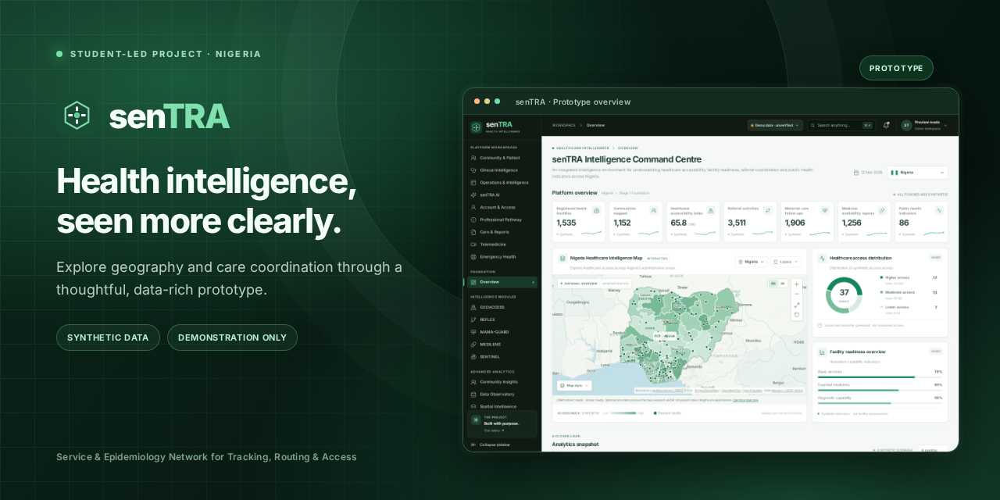
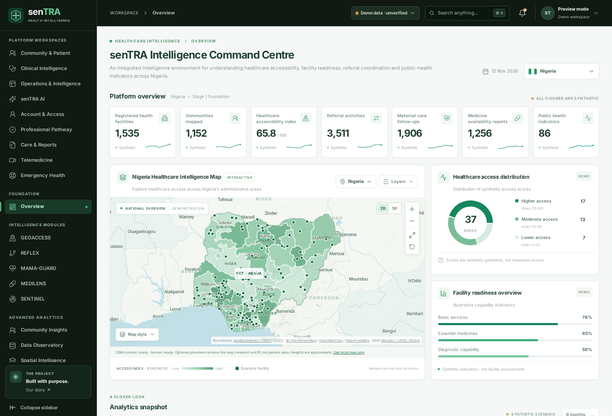
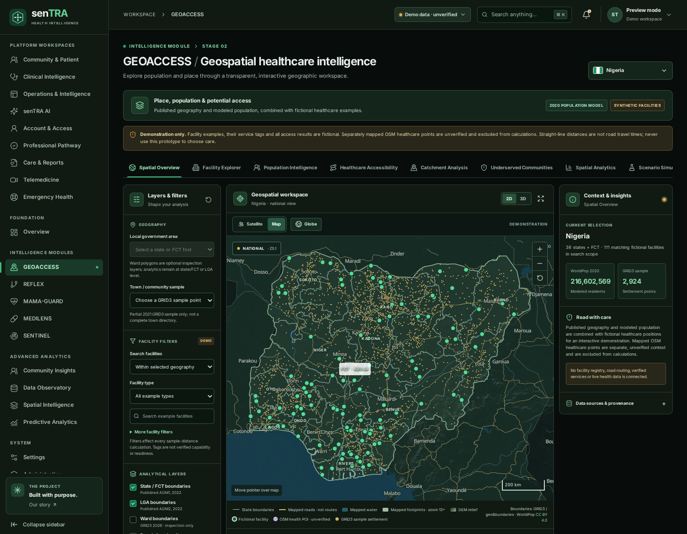

<p align="center">
  
</p>

<h1 align="center">senTRA</h1>
<p align="center"><strong>Health intelligence, seen more clearly.</strong><br />A student-led prototype exploring geography, access and care coordination in Nigeria.</p>

<p align="center">
  
  
  
  <a href="https://github.com/AdemolaTolulope/sentra-prototype/stargazers"></a>
</p>

<p align="center">
  <a href="#the-idea">The idea</a> · <a href="#explore-the-prototype">Explore the prototype</a> · <a href="#see-it-in-action">Screenshots</a> · <a href="#run-locally">Run locally</a> · <a href="#support-the-project">Support the project</a>
</p>

> **Prototype only — never enter real patient or professional information.** Health records, facilities, indicators, referrals and alerts in this project are fictional examples. Geographic context includes published boundaries and modeled population data. Nothing here is a validated clinical tool, live healthcare service, verified facility directory, emergency service or road-routing system. Sign-in, registration and recovery are disabled until a suitable identity provider is configured and tested.

## The idea

**senTRA** stands for **Service & Epidemiology Network for Tracking, Routing & Access**. It brings maps, illustrative health indicators and simulated care pathways into one interface so people can explore what a more connected health-intelligence experience might look like.

The project is a student-led innovation representing the Department of Biochemistry, Faculty of Science, Adekunle Ajasin University (AAUA), Akungba-Akoko, Ondo State, Nigeria, for the **USPF Changemaker Challenge 2026 — Healthcare Sector**. Representation does not imply university endorsement or an institutional partnership.

If thoughtful, responsible health technology interests you, **tap the ⭐ Star button at the top of this repository** to follow the project and help others discover it.

## Explore the prototype

| Experience | What you can explore | Important boundary |
| --- | --- | --- |
| **Intelligence overview** | A Nigeria-focused dashboard with interactive geography and illustrative indicators. | Dashboard figures and facility markers are synthetic, not measured healthcare outcomes. |
| **GEOACCESS** | Boundaries, modeled population, map layers, fictional facilities and geographic scenarios. | Straight-line distance is not travel time; examples do not establish real service availability. |
| **REFLEX** | Local, synthetic referral tracking, matching, network views and scenario exploration. | No person or facility is contacted, and no real referral is sent. |
| **MAMA-GUARD** | Maternal and newborn coordination concepts using fictional examples. | No booking, diagnosis, clinical record or real-world care service is provided. |
| **Connected workspaces** | Community, clinical and operations interface previews, plus account and other service boundaries. | Identity, clinical AI, telemedicine, dispatch and professional verification are not connected. |

These areas are demonstrations, not a single authenticated patient platform. Some controls are deliberately disabled. See the [technical reference](docs/PROJECT-REFERENCE.md) for the complete capabilities and limitations.

## See it in action

Actual screenshots captured from the running prototype. The figures and fictional facility markers shown are **synthetic**; the geography and modeled-population context have their own sources and limitations.

### Intelligence overview



### GEOACCESS map workspace



The screenshots include published map context; see [data and imagery attribution](public/data/ATTRIBUTION.md). The repository cover is a designed graphic using the actual overview screenshot. Screenshot dates use a fixed test clock.

**Public demo:** the Render deployment files are prepared, but a public Render deployment has not yet been verified. [Read the deployment guide](docs/MILESTONE-1-RENDER-PROTOTYPE.md).

## Run locally

**Requirements:** Node.js 22 or newer, npm and a WebGL 2-capable browser. The frontend demonstrations run without API credentials.

```bash
git clone https://github.com/AdemolaTolulope/sentra-prototype.git
cd sentra-prototype
npm ci
npm run dev
```

Open the local address printed by Vite. To build the frontend, run `npm run build`; on a memory-constrained machine, try `NODE_OPTIONS=--max-old-space-size=768 npm run build`.

The separate [backend guide](backend/README.md) explains how to run the **synthetic-only** API. Without that API, the account screen reports the backend as unavailable; with the default unconfigured API, sign-in remains disabled. Do not put real health data in either setup.

### Useful checks

```bash
npm run typecheck
npm run test:data
npm run test:geo
npm run test:reflex
npm run test:platform
npm run test:identity:client
npm run test:mamaguard
```

Browser and backend test instructions, source limitations and data provenance are in the [technical reference](docs/PROJECT-REFERENCE.md) and [backend guide](backend/README.md).

## Inside the repository

| Path | What it contains |
| --- | --- |
| [`src/`](src/) | React/TypeScript application, GEOACCESS, REFLEX, MAMA-GUARD and shared components. |
| [`public/`](public/) | Static app assets, geographic context, demo data and attribution. |
| [`backend/`](backend/) | FastAPI routes and the synthetic-only identity foundation. |
| [`docs/`](docs/) | Project reference, deployment guides, safety notes and screenshots. |
| [`scripts/`](scripts/) | Data preparation, checks and browser-test scripts. |
| [`Dockerfile`](Dockerfile) and [`render.yaml`](render.yaml) | Single-origin, synthetic-only Render deployment configuration. |
| [`package.json`](package.json) | Frontend dependencies and development/test commands. |
| [`CONTRIBUTING.md`](CONTRIBUTING.md) · [`SECURITY.md`](SECURITY.md) | How to participate and report security concerns responsibly. |

## Built with

- **Frontend:** React, TypeScript and Vite.
- **Geographic visualisation:** MapLibre GL, deck.gl and attributed reference data.
- **Synthetic API:** FastAPI and a local SQLite demonstration store.
- **Deployment:** a prepared Docker image and Render Blueprint; the actual Render build is not yet verified.

See the [architecture overview](docs/ARCHITECTURE.md) for the data boundaries and how the pieces fit together.

## Roadmap

- [ ] Deploy and verify the **synthetic** prototype on Render.
- [ ] Test a managed identity provider and test mailbox; resolve safe professional-role continuation.
- [ ] Design protected, durable shared storage and appropriate deployment controls.
- [ ] Complete independent security, privacy and clinical review before considering any real-data pilot.

The free Render configuration uses temporary local storage; synthetic sessions and records can disappear on spin-down, restart or redeploy. No production-readiness or regulatory-compliance claim is made. See the [identity handover](docs/MILESTONE-1-HANDOVER.md) and [security/data map](docs/MILESTONE-1-SECURITY-AND-DATA-MAP.md).

## Support the project

- **⭐ Star the repository** if you would like to follow its progress.
- **Share it** with people interested in geospatial tools, responsible health technology and student innovation.
- **Suggest an improvement** through [GitHub Issues](https://github.com/AdemolaTolulope/sentra-prototype/issues). Please use fictional examples only and never include private information or credentials.

Read [CONTRIBUTING.md](CONTRIBUTING.md) before proposing changes and [SECURITY.md](SECURITY.md) for security concerns. No open-source license has yet been selected for the project; contact the repository owner about reuse or code contributions. Third-party datasets and imagery have their own licenses and attribution requirements.
