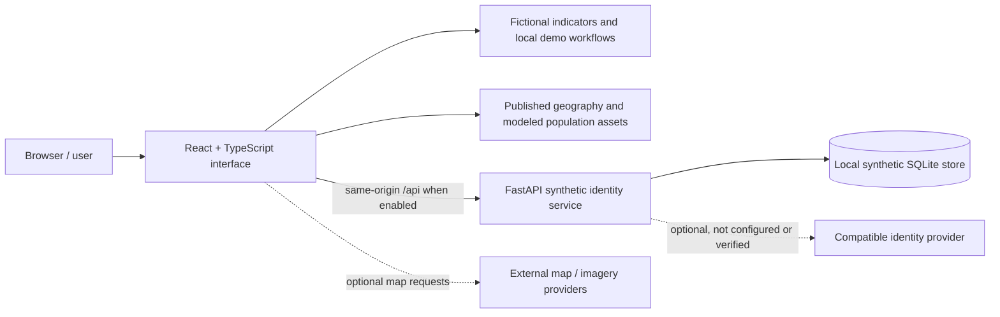

# Architecture at a glance

senTRA combines browser-based demonstrations with a separate, synthetic-only identity API. The diagram describes the prepared prototype, **not** a live clinical platform or a production deployment.

## What each part does

- **Frontend:** React/Vite renders the overview, GEOACCESS, REFLEX, MAMA-GUARD and other workspaces. Some demo state uses browser storage; MAMA-GUARD examples are held in the current tab. These stores are not secure medical records.
- **Maps and reference data:** MapLibre and deck.gl display published geographic context and modeled population alongside fictional facility examples. Optional third-party map/imagery providers may receive the browser's IP address and geographic viewport. Their licences, coverage and availability differ; see [attribution](../public/data/ATTRIBUTION.md).
- **Identity API:** FastAPI provides limited synthetic account, profile and consent examples. No identity provider or mailbox is connected by default, and sign-in/registration/recovery are disabled. The other workspaces are not protected by this API.
- **Synthetic SQLite:** Local storage is unencrypted and is not appropriate for real health data. The prepared free Render service would lose its local database on spin-down, restart or redeploy.
- **Deployment:** The root Dockerfile and Render Blueprint prepare a single-origin frontend/API service. The Docker image and actual Render deployment have not been independently verified.

There is no connected clinical AI, live facility registry, real referral delivery, road-routing engine, telemedicine or emergency dispatch. Never enter real patient or professional information. The [technical reference](PROJECT-REFERENCE.md) and [security/data map](MILESTONE-1-SECURITY-AND-DATA-MAP.md) cover the detailed limitations and remaining work.
